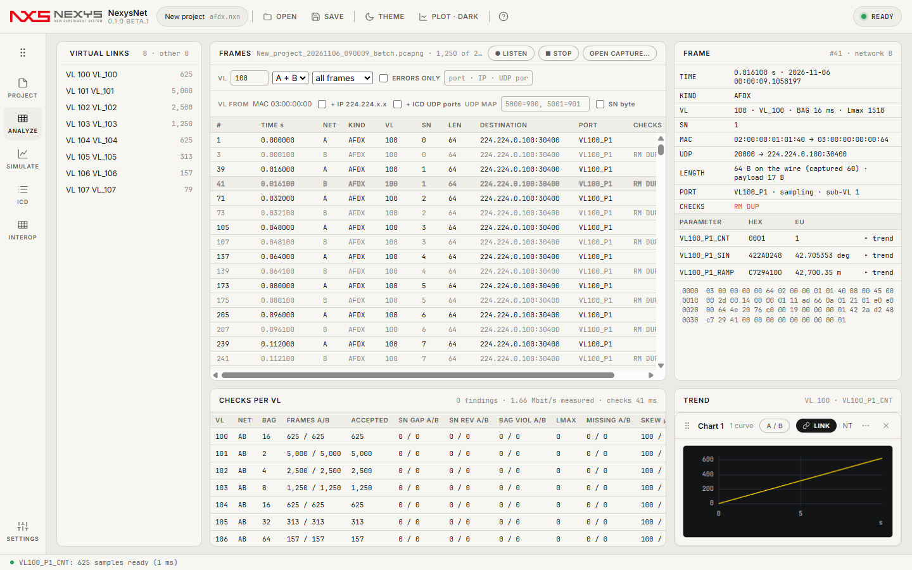

<p align="center"></p>

# NexysNet

**ARINC 664 Part 7 (AFDX) 네트워크 캡처 · 검사 · 송신 · 상호운용 체크리스트 — 가상 네트워크로 지금 바로, 이더넷 포트는 패킷 캡처 라이브러리(Npcap, 별도 설치)가 있는 PC에서 같은 화면으로.**

   

C# 12 / .NET 8 · WPF 창 + WebView2 페이지(TypeScript) · 엔진과 창 셸은 [nexys-core](https://github.com/Kim-Hakseong/nexys-core) submodule

> NexysNet은 [NexysBus](https://github.com/Kim-Hakseong/nexys-bus) 0.4.0-beta.1/beta.2의 ARINC 664 기능을 별도 앱으로 옮긴 것입니다(RUN-SPLIT). 기능·관문은 NexysBus 0.4.0-beta.2와 같고, 버스 시뮬레이션·버스 캡처 분석은 NexysBus에 남았습니다. NexysBus 0.4에서 저장한 664 프로젝트(`.nxb`, protocol `arinc664`)는 NexysNet에서 그대로 열립니다. **앱 이름 "NexysNet"은 임시**입니다(결정 대기).

## 사용 가이드
**처음이라면 → [사용 가이드](docs/guide/README.md)** · 실물 장비 없이 내 VI로 시험 → **[내 VI로 시험하기](docs/guide/quick-vi.md)**(빨간 박스 그림 따라 10분) · 모든 기능 → [자세한 설명서](docs/guide/reference.md). 앱 안에서는 F1.



## 설치와 실행
- **설치형**: [Releases](https://github.com/Kim-Hakseong/nexys-net/releases)의 `NexysNet-0.1.0-beta.2-setup.exe`. Program Files에 설치, `.nxn`/`.pcapng` 연결은 선택(기본 해제). WebView2 런타임이 없으면 설치 중 받는다.
- **포터블**: `NexysNet-0.1.0-beta.2-portable.exe` 1개.
- **소스**: `git clone --recurse-submodules` → `cd app/web && npm install && npm run build` → `dotnet build app/NexysNet.App/NexysNet.App.csproj -c Release` → `app\NexysNet.App\bin\Release\net8.0-windows\win-x64\NexysNet.exe` (nexys-core가 비공개라 소스 빌드는 core 접근 권한이 있을 때만)

## 화면 (왼쪽 레일)
| 레일 | 내용 |
|---|---|
| **시작** | NEW PROJECT · OPEN PROJECT… · OPEN CAPTURE… · 최근 프로젝트 |
| **PROJECT** | 이름 · 파일(`.nxn` JSON) · 캡처 폴더 · 장치(Virtual network · Shared virtual network(이 PC의 다른 NexysNet과) · Ethernet ports A/B · AFDX 카드 자리) · NETWORK A/B 포트 · 검사 기준 · ICD 요약 |
| **ANALYZE** | VL 트리 · 100만 프레임 목록(가상 스크롤) · 필터 · VL FROM 폴백(IP 224.224.x.x · ICD UDP 포트 · UDP 맵 · SN 바이트) · ● LISTEN(수신 전용) · 디코드 · VL별 검사표 · 큐잉/서브 VL 표 · 추이 |
| **SIMULATE** | VL 송신(BAG 스케줄러, SN 자동, A/B, 서브 VL 라운드로빈, 큐잉 포트 IP 단편화) · START/STOP · 10 s BATCH · SENDER FAULTS · VIRTUAL NETWORK 지연·손실·스큐 |
| **ICD** | VL → 포트 → 파라미터(허브 스키마 1.1) · IMPORT(CSV · XLSX · 허브 JSON) · 표 편집 · VALIDATION · EXPORT CSV |
| **INTEROP** | PEER → NEXYSNET 자동 판정(VL 수신 · ICD 밖 VL · SN · BAG · Lmax · A/B · 스큐 · 재조립 · 서브 VL 순서 · 디코드, FAIL마다 근거 프레임 링크) · NEXYSNET → PEER 표(보낸 수 vs 상대 보고, IMPORT PEER CSV…) · WIRESHARK PROFILE… · EXPORT REPORT… |
| **SETTINGS** | 테마 · 플롯 · 캡처 폴더 · 설정 파일(`%LOCALAPPDATA%\NexysNet\settings.json`) |

## 수치 (NexysBus 0.4.0-beta.2에서 측정, NexysNet 0.1.0-beta.1·beta.2에서 같은 관문 재실행)
| 관문 | 결과 |
|---|---|
| `--afdx` (사용자 경로 · 정답지 · 오류 주입 · VL 폴백 · 단편화 · 상대 CSV · Wireshark 교차 대조 · 1,000 VL-초 · 실시간 BAG · 100만 프레임) | 29 / 29 PASS |
| Wireshark(tshark) 교차 대조 — 코퍼스 8개 + 실캡처 1개 | 340 / 340 |
| 두 인스턴스(공유 가상 네트워크) | 6/6 VL·네트워크 행 보낸 수 = 받은 수 · SN 손실 0 · BAG 위반 0 |
| 실제 NIC 수신(Npcap) | 장시간 수신 SN 손실 0 |

## 네트워크 포트
패킷 캡처 라이브러리(Npcap)는 **배포물에 넣지 않는다** — 설치돼 있으면(`%SystemRoot%\System32\Npcap\wpcap.dll`) 실행 시 묶어서 PROJECT의 Ethernet ports와 NETWORK A / B 포트 선택이 켜지고, 없으면 가상 네트워크만 보인다. 전용 AFDX 카드는 인터페이스 자리만 있다. Wi-Fi 어댑터는 원시 이더넷 프레임 송신을 거절하는 경우가 많다(송신 시험은 유선 포트로).

## 자동화
```
NexysNet.exe --afdx --out <dir> [--corpus <dir>] [--tshark <dir>] [--frames N] [--rtseconds s]
NexysNet.exe --afdx --rtonly --rtmode sleep|hires|spin [--minimized] --rtseconds 60 --out <dir>
NexysNet.exe --interop --transport local|nic [--nic "<port>"] [--seconds 20] --out <dir>
NexysNet.exe --site --profile <file.json> --out <dir>          (docs/site-profile.md)
NexysNet.exe --startmem --out <dir>                             (시작 메모리 · 레일)
```

## 파일
- `.nxn` 프로젝트(JSON): protocol `arinc664` · device · icd(허브 스키마 1.1 `vls`) · afdx(포트 · 검사 설정 · 송신 · VL FROM · 상대 보고). NexysBus 0.4의 `.nxb`(protocol `arinc664`)도 연다.
- `.pcapng` / `.pcap`: 인터페이스 = 네트워크 A/B, NexysNet이 쓰는 파일은 ns 타임스탬프 · FCS 없음. Wireshark/dumpcap 파일을 그대로 연다.

## 개발
```
app/NexysNet.App/   Program · App · MainWindow(호스트 명령) · Services/NetEngine(프로젝트·레일·브리지 명령) · Services/AfdxService(송수신·검사·추이·상호운용) · Services/WiresharkProfile · SelfTest*(--afdx · --interop · --site · --startmem; 러너는 core SelfTestKit)
app/web/            main(@core/shell 위의 레일 구성) · start · project · afdx(ICD·SIMULATE·ANALYZE·INTEROP) · settings · help · net.css
app/core/           nexys-core submodule (Core: Protocols/Arinc664 · Render · Host: AppShell · ShellStore · SelfTestKit · Web: shell.ts · shell.css)
installer/          NexysNet.iss
```

## 라이선스
MIT — [LICENSE.txt](LICENSE.txt).
