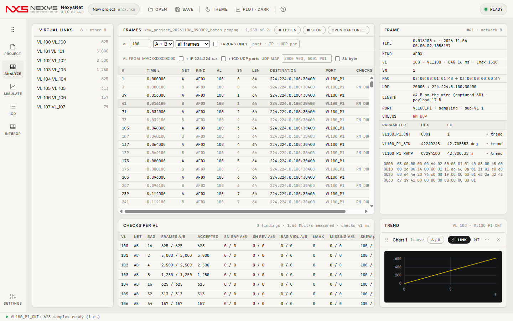

# NexysNet 사용 가이드

NexysNet은 **ARINC 664(AFDX) 네트워크 데이터를 받아서 값으로 보여 주고, 규칙대로 검사하고, 시험용으로 보내기도 하는** Windows 프로그램입니다. Wireshark로 하던 "제대로 보냈나 · 받았나 · 간격은 맞나"를 한 화면에서 합니다.

## 무엇부터 볼까요?

| 나는… | 여기부터 |
|---|---|
| 실물 장비 없이 **내 VI**(UDP로 보내는 계측 프로그램)로 시험하고 싶다 | **[내 VI로 시험하기 →](quick-vi.md)** (그림 따라 10분) |
| 받은 **캡처 파일(.pcapng)** 을 열어 보고 싶다 | 아래 "캡처 파일 열기" |
| 장비 없이 **NexysNet만으로** 송신·수신을 체험하고 싶다 | 아래 "가상 네트워크로 체험" |
| 모든 기능 · 검사 규칙 · 자동 검증 | [자세한 설명서](reference.md) |

## 화면 한눈에

왼쪽 레일 6개만 기억하면 됩니다.

| 레일 | 하는 일 |
|---|---|
| **PROJECT** | 어떤 네트워크로 받을지 고름(가상 네트워크 / 이더넷·Wi-Fi 어댑터) |
| **ICD** | "어느 VL의 몇 번째 바이트가 무슨 값인지" 정의 — CSV로 가져오기 |
| **ANALYZE** | 받기(● LISTEN) · 목록 · 값 · 그래프 · 검사 |
| **SIMULATE** | ICD의 VL을 규칙대로 보내기 |
| **INTEROP** | 상대 장비와의 합격/불합격 체크리스트 · 보고서 |
| **SETTINGS** | 테마 · 캡처 폴더 |

## 캡처 파일 열기 (1분)
1. 시작 화면 **OPEN CAPTURE…** → `.pcapng` / `.pcap` 선택(창에 끌어다 놓아도 됨).
2. 값까지 보려면 **ICD** 레일 → **IMPORT…** 로 ICD를 가져옵니다.
3. **ANALYZE**에서 행을 누르면 값, **CHECKS PER VL**에서 VL별 오류.

## 가상 네트워크로 체험 (3분, 장비·Npcap 없이)
1. **NEW PROJECT** → PROJECT에서 **Virtual network**(기본값).
2. **ICD** → **SAMPLE**(예제 VL 6개).
3. **SIMULATE** → **10 s BATCH**(10초 분량을 바로 만들어 보냄).
4. **ANALYZE** 레일에서 보낸 프레임 · 값 · 검사 확인, **INTEROP**에서 체크리스트 → **EXPORT REPORT…**

## 꼭 알아 둘 것
- 실제 네트워크 어댑터를 쓰려면 **Npcap**(무료, [npcap.com](https://npcap.com))을 따로 설치합니다. NexysNet에는 들어 있지 않습니다.
- 노트북 **Wi-Fi는 받기만** 됩니다(드라이버가 AFDX 프레임 송신을 막음). 보내기 시험은 유선 이더넷으로.
- 앱 안에서 **F1** = 도움말. 문제는 [GitHub Issues](https://github.com/Kim-Hakseong/nexys-net/issues)로.
