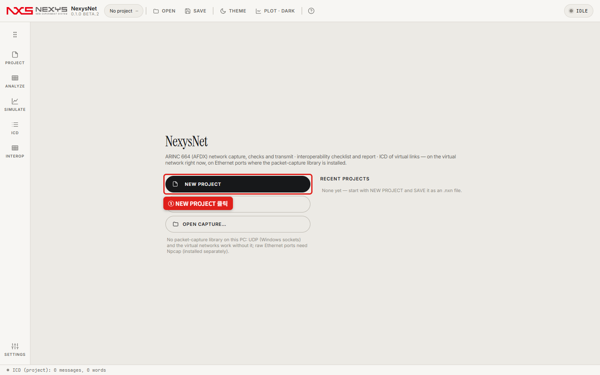
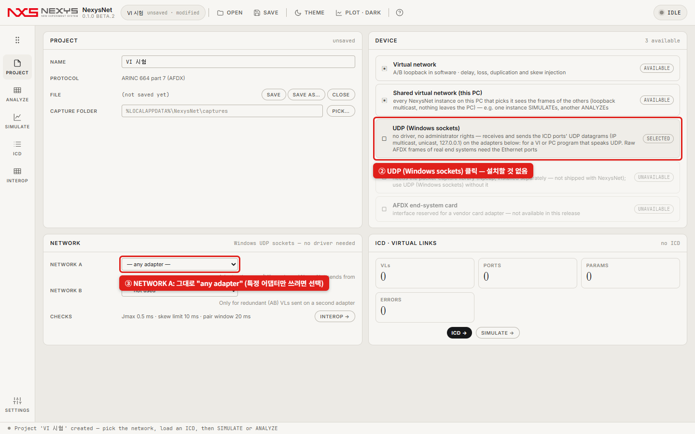
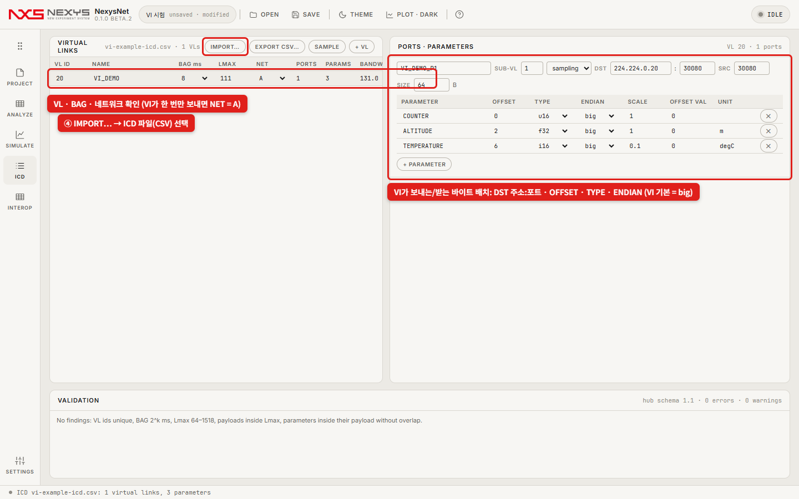
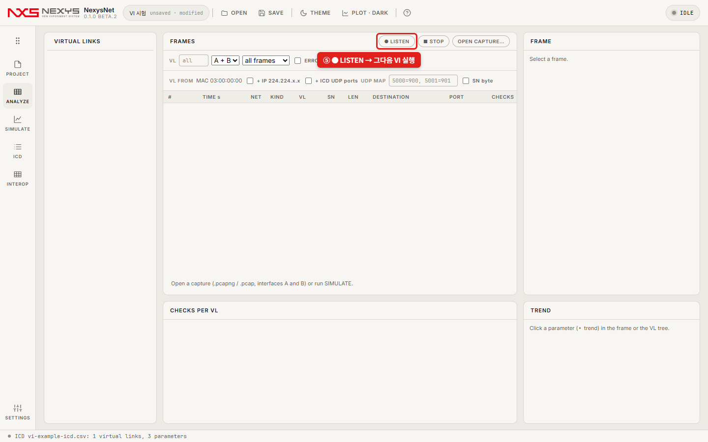
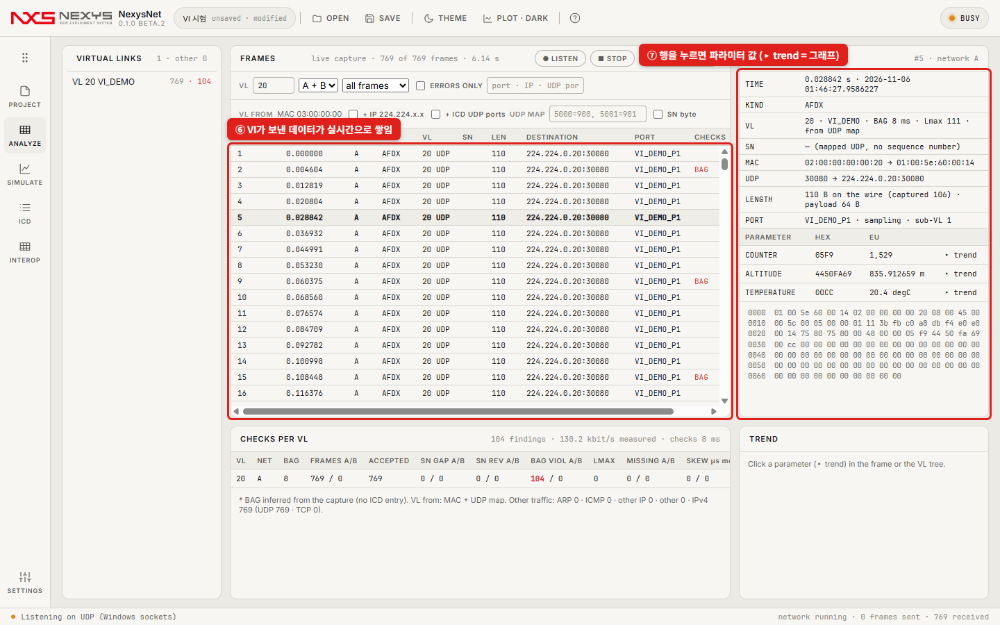
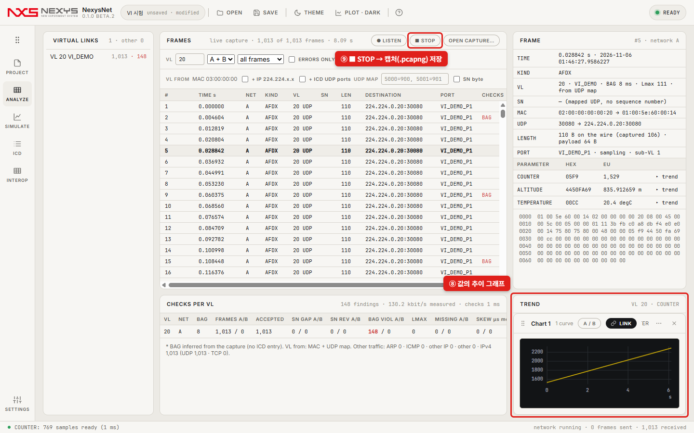
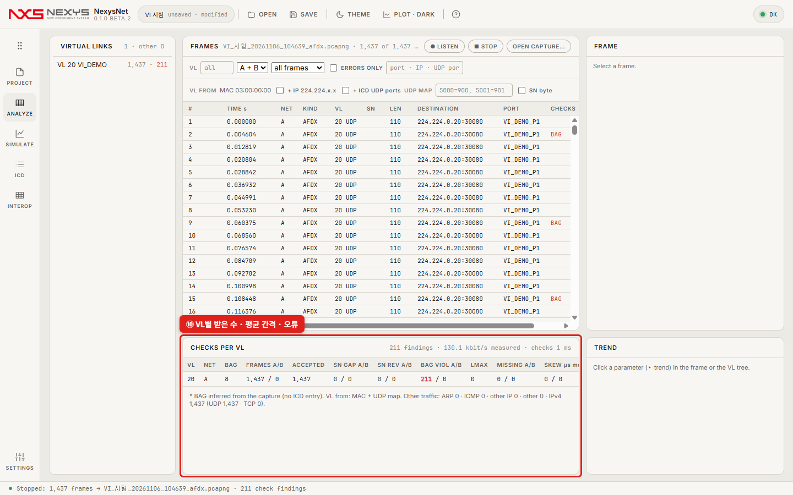
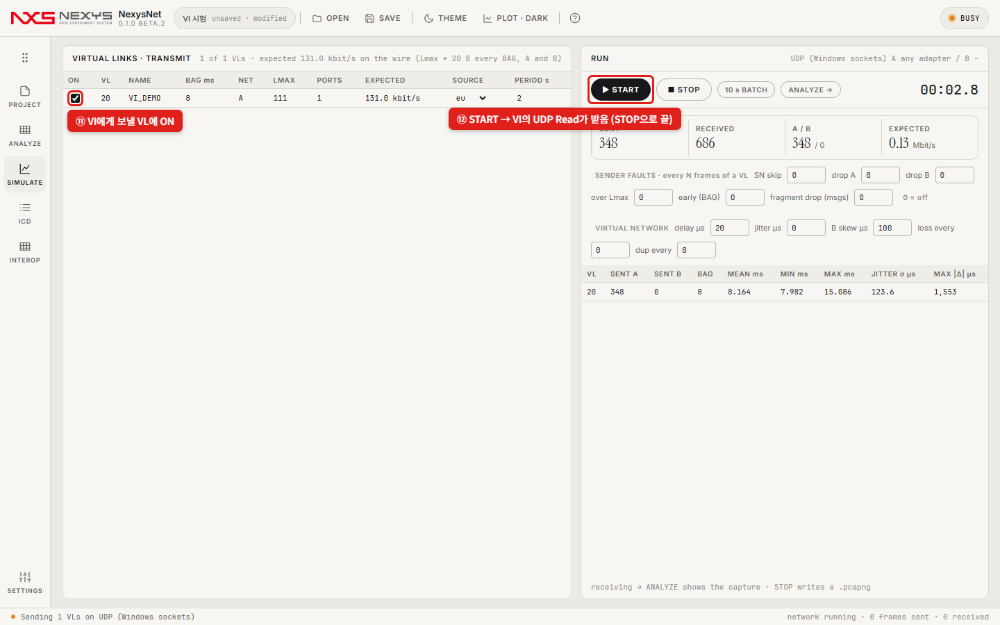

# 내 VI로 시험하기 — 실물 664 장비 없이 (빠른 시작)

**이런 경우에 씁니다**: 실물 ARINC 664 장비가 없고, 내 VI(계측 프로그램)가 UDP로 데이터를 주고받을 때. PC 한 대로 됩니다.

- **VI → NexysNet**: VI가 보낸 데이터를 NexysNet이 받아서 **값으로 풀어 보여 주고**, 간격·누락을 검사합니다.
- **NexysNet → VI**: NexysNet이 ICD대로 보내고 VI의 UDP Read가 받습니다.

```
 [   내 VI    ]  ◀──── UDP (멀티캐스트 224.224.x.x 또는 127.0.0.1) ────▶  [ NexysNet ]
```

준비물: **NexysNet만** 있으면 됩니다(설치형 또는 포터블). Npcap · Wireshark · 드라이버 · 관리자 권한 모두 **필요 없습니다** — 장치 **UDP (Windows sockets)** 가 Windows 기본 UDP로 주고받습니다.

---

## 1단계. ICD 파일 만들기 (주고받는 데이터의 모양)

NexysNet은 **ICD**를 보고 "어느 주소:포트로 오는 데이터의 몇 번째 바이트가 무슨 값인지"를 압니다. 예제 [`examples/vi-example-icd.csv`](examples/vi-example-icd.csv)를 복사해서 내 VI에 맞게 고치세요(Excel로 열어도 됩니다). **파라미터 하나당 한 줄**입니다.

| 열 | 예제 값 | 뜻 — 내 VI에 맞게 |
|---|---|---|
| `vl_id` | 20 | VL 번호(아무 숫자, 0~65535) |
| `vl_name` | VI_DEMO | 이름 |
| `bag_ms` | 8 | 보내는 **주기(ms)**. 1 · 2 · 4 · 8 · 16 · 32 · 64 · 128 중 하나 |
| `lmax` | 111 | 프레임 최대 길이 = **size + 47** (예: 64 + 47) |
| `network` | A | 한 번만 보내면 **A** |
| `ip_dst` | 224.224.0.20 | **목적지 IP**(멀티캐스트 224.224.x.x 권장, 127.0.0.1도 됨) |
| `udp_dst` | 30080 | **목적지 포트** — NexysNet이 이 포트로 받고 보냅니다 |
| `size` | 64 | 한 번에 보내는 **바이트 수** |
| `param` | ALTITUDE | 값 이름 |
| `offset` | 2 | 그 값이 시작하는 **바이트 위치**(0부터) |
| `type` | f32 | u8 · i8 · u16 · i16 · u32 · i32 · f32 · f64 … |
| `endian` | big | VI의 Flatten To String · Type Cast 기본은 **big** |
| `scale`, `offset_val`, `unit` | 1, 0, m | 값 = 원시값 × scale + offset_val |

예제가 뜻하는 데이터(64바이트): `0~1` COUNTER(U16) · `2~5` ALTITUDE(SGL) · `6~7` TEMPERATURE(I16, ×0.1 °C) · 나머지 0.

## 2단계. VI 설정

| 방향 | VI 함수 (Data Communication › Protocols › UDP 팔레트) |
|---|---|
| **VI가 보낼 때** | **UDP Multicast Write-Only Open**(multicast address `224.224.0.20`, port `30080`, TTL 1) → 루프 안 **UDP Write**(address `224.224.0.20`, port `30080`, data = 값들을 **Flatten To String**으로 이어 붙인 문자열) + **Wait (ms) = BAG**(예: 8). 멀티캐스트 대신 **UDP Open** + UDP Write로 `127.0.0.1:30080`에 보내도 됩니다 |
| **VI가 받을 때** | **UDP Multicast Read-Only Open**(multicast address `224.224.0.20`, port `30080`) → 루프 안 **UDP Read** → **Unflatten From String**으로 값 꺼내기 |

> NexysNet과 VI가 같은 PC에서 같은 포트(30080)를 함께 써도 됩니다(멀티캐스트는 둘 다 받음). 어댑터(net address)는 비워 두면 됩니다.

## 3단계. NexysNet 설정 (빨간 박스대로)

**① 시작 화면에서 NEW PROJECT**



**② 장치 UDP (Windows sockets) 클릭 · ③ NETWORK A는 그대로 "any adapter"**(여러 어댑터 중 하나만 쓰고 싶을 때만 고릅니다). Ethernet ports가 UNAVAILABLE이어도 상관없습니다 — 그건 실물 AFDX 장비용(Npcap 필요)입니다.



**④ 왼쪽 레일 ICD → IMPORT… → 1단계의 CSV 선택**. VL 줄과 오른쪽 표(DST 주소:포트 · OFFSET · TYPE · ENDIAN)가 VI와 같은지 확인합니다. 다르면 표에서 바로 고쳐도 됩니다.



## 4단계. VI → NexysNet (받기)

**⑤ 왼쪽 레일 ANALYZE → ● LISTEN, 그다음 VI 실행**



**⑥ VI가 보낸 데이터가 실시간으로 쌓이고(VL 칸에 `20 UDP`), ⑦ 행을 누르면 오른쪽에 값(EU)이 보입니다.** VL 칸에 `20`을 넣으면 VI 데이터만 봅니다.



**⑧ 값 옆의 ▸ trend = 그래프 · ⑨ ■ STOP = 받은 것을 캡처 파일(.pcapng)로 저장**



**⑩ CHECKS PER VL — VL별 받은 수 · 평균 간격 · 오류**



- `ACCEPTED` = 받은 개수. `MEAN` 간격이 BAG(예: 8 ms)과 같으면 VI 주기가 맞는 것.
- `BAG VIOL`(빨간 숫자) = **VI가 BAG − 0.5 ms보다 빨리 보낸 횟수**. Windows에서 도는 VI 루프는 몇 ms씩 흔들리므로 흔히 나옵니다 — 값 확인이 목적이면 무시해도 됩니다.

## 5단계. NexysNet → VI (보내기)

**⑪ SIMULATE에서 VI에게 보낼 VL에 ON · ⑫ START** — VI의 UDP Read가 받습니다. 끝낼 때 STOP.



- 보내는 값은 SOURCE 칸(eu = 각 파라미터 범위의 사인, sine · ramp · const)으로 정합니다. 이름이 `_CNT`로 끝나는 파라미터는 0, 1, 2…로 세는 카운터입니다.
- 프로젝트는 상단 **SAVE**로 `.nxn`에 저장 — 다음엔 열고 ⑤부터.

---

## 안 될 때

| 증상 | 확인 |
|---|---|
| FRAMES에 아무것도 안 쌓임 | VI의 목적지 주소·포트가 ICD의 `ip_dst` · `udp_dst`와 같은지 · ICD를 가져왔는지(포트가 없으면 START/LISTEN이 "no UDP port" 안내) · Windows 방화벽이 NexysNet을 막는다고 물었다면 **허용** |
| 값이 이상함(엄청 크거나 NaN) | ICD의 `offset` · `type` · **`endian`**(VI에서 byte order를 바꿨다면 little) |
| `MISSING A/B`가 늘어남 | ICD `network`가 AB면 B 사본을 기다립니다 → **A** |
| VI가 NexysNet 데이터를 못 받음 | VI가 같은 그룹(`224.224.0.20`)·포트에 Multicast Open 했는지 · SIMULATE에서 그 VL이 ON인지 |
| 실물 AFDX 장비의 프레임이 안 보임 | 실물 장비는 원시 AFDX 프레임(MAC `03:00:00:00:…`)이라 UDP 장치로는 받을 수 없습니다 → 장치 **Ethernet ports**(Npcap 설치 필요) |

VI 없이 먼저 연습하려면: [`examples/vi_sim_sender.py`](examples/vi_sim_sender.py) — Python이 있으면 `python vi_sim_sender.py <이 PC의 IP> 60`이 예제 ICD와 같은 데이터를 60초 보냅니다(위 그림들이 이것으로 찍은 것, Npcap을 끈 상태).

더 자세한 화면·검사 규칙은 [자세한 설명서](reference.md).
