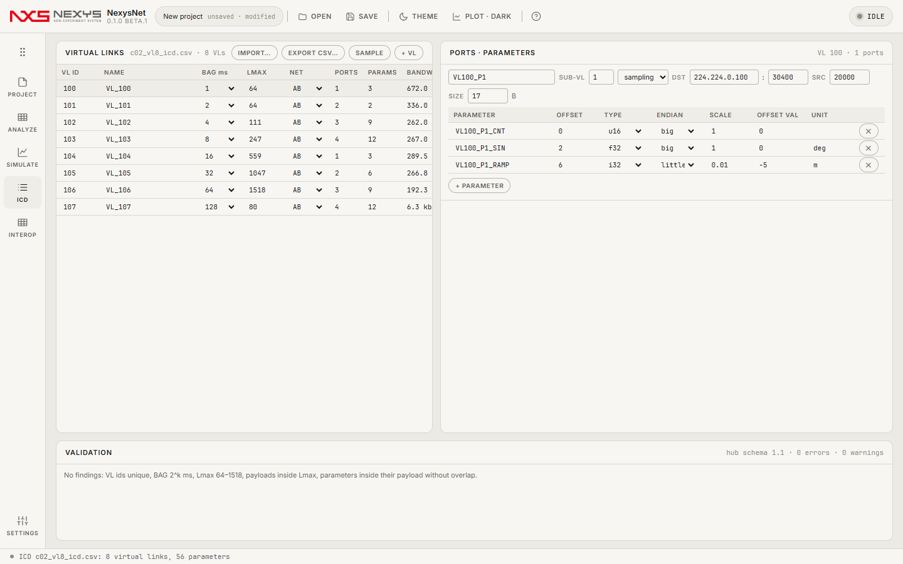
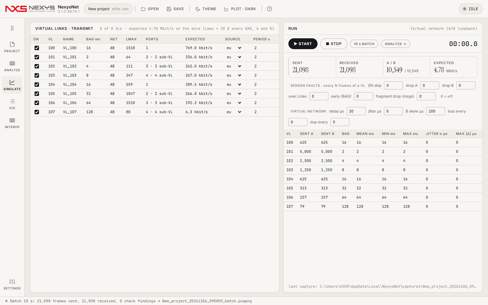
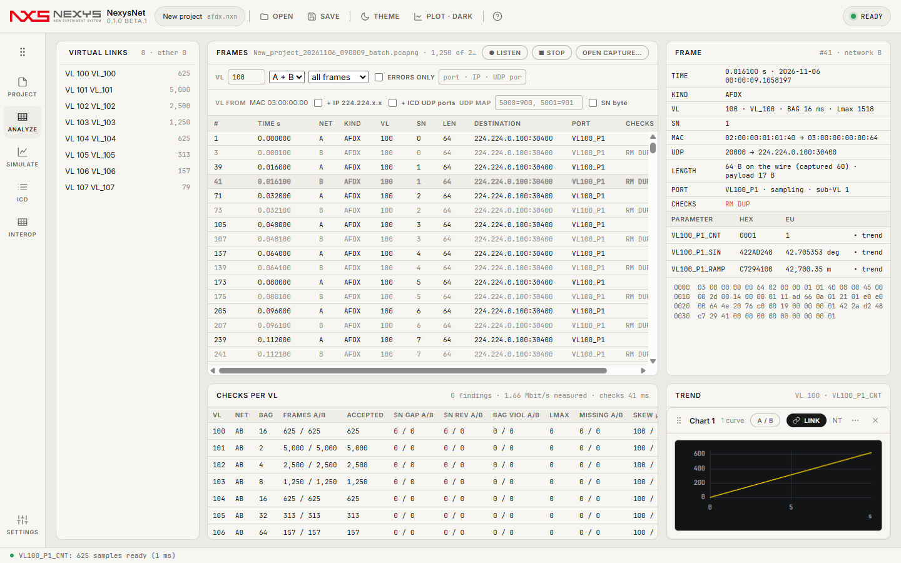
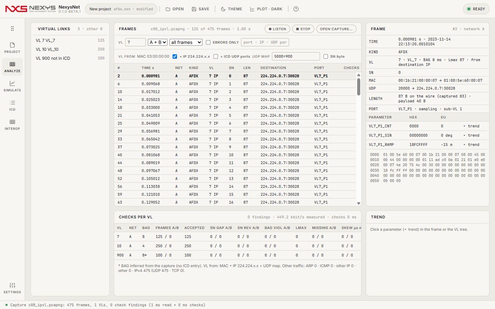
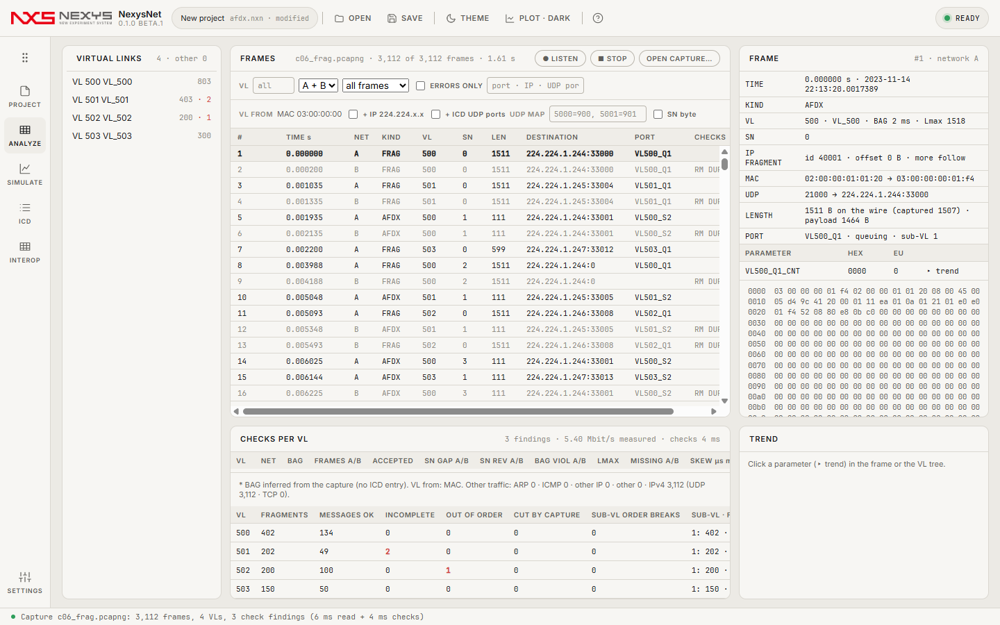
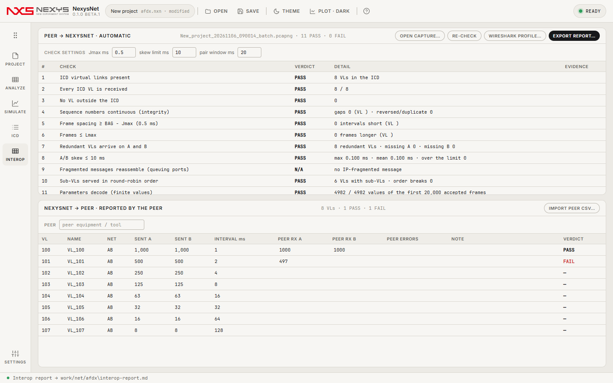
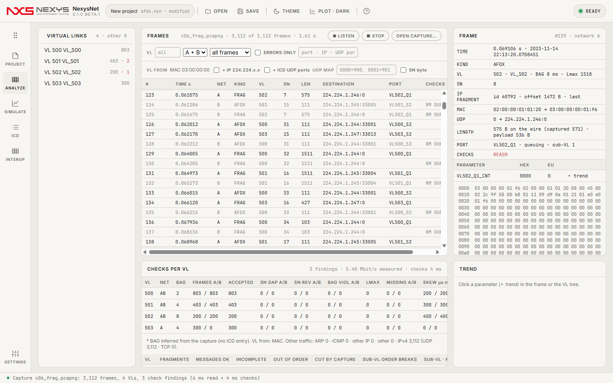
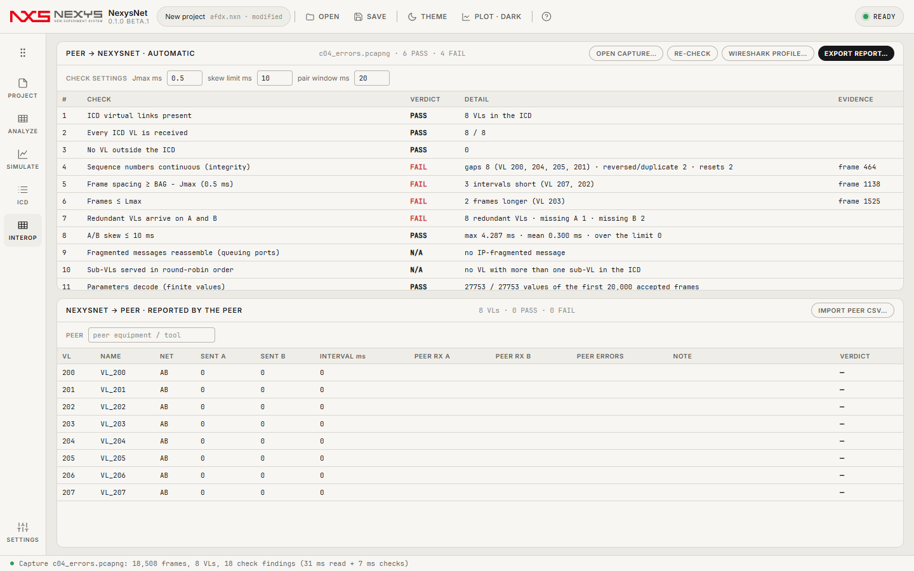
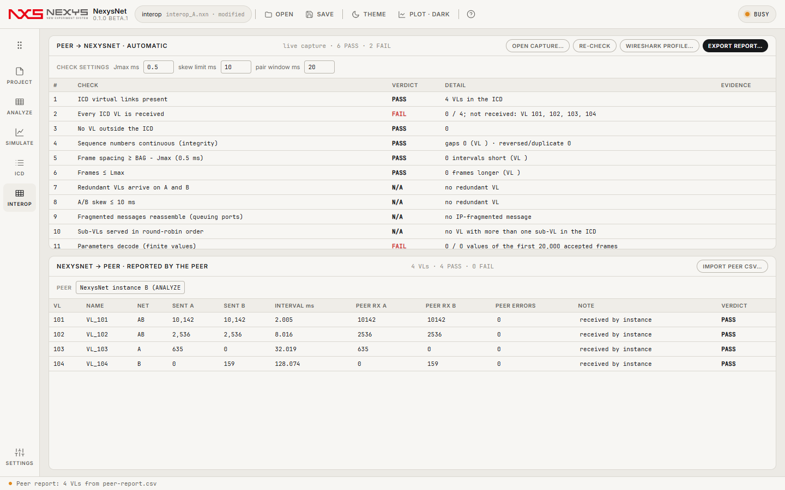

# NexysNet 자세한 설명서 — ARINC 664 (AFDX)

> 처음이라면 [사용 가이드 첫 페이지](README.md)와 [내 VI로 시험하기](quick-vi.md)부터 보세요. 이 문서는 모든 화면·검사 규칙·자동 검증의 상세 설명입니다.

NexysNet은 ARINC 664 Part 7(AFDX) 네트워크 도구입니다(NexysBus 0.4에서 시작해 0.1.0부터 별도 앱). Wireshark로 하던 "보냈나·받았나·순서·간격·이중화" 확인을 한 화면에서 합니다: **캡처**(pcapng) → **디코드**(VL · SN · A/B · ICD 파라미터 EU) → **검사**(SN 무결성 · BAG · Lmax · 이중화/스큐) → **송신 시뮬레이션** → **상호운용 체크리스트·보고서**.

## 1. 프로젝트 만들기

- 시작 화면 **NEW PROJECT**(또는 **OPEN CAPTURE…**로 캡처부터). 프로젝트 파일은 `.nxn`(JSON)이고, NexysBus 0.4에서 저장한 ARINC 664 프로젝트(`.nxb`, protocol `arinc664`)도 그대로 열립니다.
- `.pcapng`/`.pcap`을 열거나 끌어다 놓으면 ANALYZE에 열립니다.
- 레일: PROJECT(Ctrl+1) · ANALYZE(2) · SIMULATE(3) · ICD(4) · INTEROP(6) · SETTINGS(5).

**장치**(PROJECT › DEVICE)

| 장치 | 언제 | 비고 |
|---|---|---|
| Virtual network | 항상 | A/B 루프백. SIMULATE의 VIRTUAL NETWORK 칸으로 지연 · 지터 · B 스큐 · N번째마다 손실 · 중복을 넣습니다 |
| Shared virtual network (this PC) | 항상 | 이 PC에서 같은 장치를 고른 **NexysNet 인스턴스끼리** 프레임을 주고받습니다(루프백 멀티캐스트, PC 밖으로 나가지 않음). 한 창은 SIMULATE로 보내고 다른 창은 ANALYZE › LISTEN으로 받는 식 — 6장 참고. 자기가 보낸 프레임은 자기에게 돌아오지 않습니다(실제 포트처럼) |
| UDP (Windows sockets) | 항상(드라이버 · 관리자 권한 불필요) | ICD 포트의 UDP를 Windows 기본 소켓으로 주고받습니다 — VI · PC 프로그램처럼 일반 UDP를 쓰는 상대용. 멀티캐스트(ICD `ip_dst`) · 유니캐스트 · 127.0.0.1을 `udp_dst` 포트로 받고, 송신은 ICD 목적지로 보냅니다. VL은 포트로 자동 매핑(VL FROM 설정 불필요). 받은 데이터그램의 이더넷/IP 헤더는 목록·검사를 위해 다시 만든 것입니다. NETWORK A/B = 어댑터(비우면 A = 모든 어댑터). 실물 AFDX 장비의 원시 프레임은 못 받습니다 → Ethernet ports. 단계별: [내 VI로 시험하기](quick-vi.md) |
| Ethernet ports (A / B) | 패킷 캡처 라이브러리(Npcap)가 설치된 PC | NexysNet에 들어 있지 않으며 따로 설치합니다. PROJECT › NETWORK A / B에서 포트를 고릅니다. 같은 포트를 둘 다 고르면 출발지 MAC의 인터페이스 id로 A/B를 나눕니다 |
| AFDX end-system card | — | 전용 카드 어댑터 자리만 있습니다(이번 버전에서는 사용할 수 없음) |

## 2. ICD (허브 스키마 1.1)



VL → 포트 → 파라미터 3단입니다.

- **VL**: `vl_id`(0…65535), `name`, `bag_ms`(1·2·4·…·128), `lmax`(64…1518 B, FCS 포함), `network`(A · B · AB). BANDWIDTH = (Lmax + 20) × 8 / BAG.
- **포트**: `sub_vl`(1…4), `port_type`(sampling · queuing), `ip_src`, `ip_dst`, `udp_src`, `udp_dst`, `size`(UDP 페이로드: sampling 1…1471 B, 17 B 미만은 선로에서 17 B로 패딩. **queuing은 8192 B까지** — 한 프레임(Lmax)에 안 들어가면 IP 단편으로 나눠 보냅니다. VALIDATION에 `info: … sent as N IP fragments`로 표시).
- **파라미터**: `offset`(페이로드 안 바이트 위치), `type`(u8 i8 u16 i16 u32 i32 u64 i64 f32 f64), `endian`(big · little), `scale`, `offset_val`, `unit`. EU = raw × scale + offset_val.

**IMPORT…**: CSV · XLSX(첫 시트)는 파라미터당 1행이고 열 이름을 자동으로 알아봅니다(`vl_id`·`vl`, `bag_ms`·`bag`, `udp_dst`·`dst_port`, `param`·`name` …). 허브 JSON(`vls` 포함)도 됩니다. **EXPORT CSV…**, **SAMPLE**(6 VL 예제), **+ VL**, 포트별 **+ PARAMETER**.

**VALIDATION**: error(내보내기·실행 전 고칠 것) — VL id 중복 · BAG가 2^k 아님 · Lmax 범위 · 페이로드가 Lmax를 넘음 · 파라미터가 페이로드 밖 · 바이트 겹침 · 모르는 type. warning — 같은 목적지 IP:포트 중복, sub-VL 1…4 밖.

## 3. SIMULATE — 송신



- **VIRTUAL LINKS · TRANSMIT**: ON(이 VL을 보낼지), 데이터 소스(eu = 각 파라미터 범위의 80 % 사인, sine · ramp · const), PERIOD s. `_CNT`로 끝나는 파라미터는 프레임 카운터(0, 1, 2…)입니다.
- 송신 규칙: VL마다 BAG마다 한 프레임, 이중화(AB) VL은 A·B 동시, SN 자동(VL 단위, 시작 0, 이후 1…255 순환). **서브 VL 라운드로빈**: 슬롯마다 다음 서브 VL(오름차순)의 큐에서 한 프레임을 꺼내고, 큐가 비면 그 서브 VL의 다음 포트 메시지로 채웁니다. 큐잉 포트의 큰 메시지는 IP 단편(조각당 ⌊(Lmax − 39) / 8⌋ × 8 B)이 되어 그 서브 VL의 차례마다 한 조각씩 나갑니다 — 단편 하나 = 프레임 하나 = SN 하나.
- **START / STOP**: 실시간(전용 스레드, 1 ms 타이머 + 마지막 1.5 ms 바쁜 대기). 받은 프레임이 ANALYZE에 쌓이고 STOP하면 `.pcapng`로 저장됩니다. **10 s BATCH**: 가상 시계로 10초치를 즉시 만듭니다(간격이 BAG과 정확히 같음 — 정답지용).
- RUN 표: SENT A/B, 실제 송신 간격 MEAN/MIN/MAX, JITTER σ(예정 시각 대비), MAX |Δ|. 스레드가 늦게 깨어나 예정보다 0.25 ms 넘게 늦으면 몰아서 보내지 않고 일정을 뒤로 밉니다. 간격은 장치가 프레임을 실제로 내보낸 시각(LastSendNs)으로 재고, 네트워크(A/B)마다 "직전 프레임 + BAG − 0.25 ms" 전에는 보내지 않습니다 — A 사본과 B 사본 사이에 멈춤이 있어도 어느 네트워크에서도 BAG − Jmax보다 좁은 간격이 생기지 않습니다.
- 포트(드라이버)가 프레임을 거절하면(예: 원시 프레임 송신을 지원하지 않는 Wi-Fi 어댑터) RUN 아래에 `the port refused to send (N frames): …`가 뜨고 SENT는 늘지 않습니다.
- **SENDER FAULTS**(VL의 N번째 정규 프레임마다): SN skip · drop A · drop B · over Lmax · early(0.1 ms 뒤 한 프레임 더 = BAG 위반) · fragment drop(단편화된 N번째 메시지마다 가운데 조각 하나를 빼고 보냄 = 재조립 실패). **VIRTUAL NETWORK**: delay · jitter · B skew(µs) · loss every · dup every.

## 4. ANALYZE — 캡처와 검사



- **VIRTUAL LINKS**(왼쪽): VL별 채택 프레임 수와 검사 건수. VL을 누르면 그 VL만 보이고, 펼치면 ICD 파라미터(▸ 추이).
- **● LISTEN / ■ STOP**: 프로젝트의 네트워크(가상 · 공유 가상 · 이더넷 포트)에서 **받기만** 합니다(아무것도 보내지 않음). 목록이 실시간으로 늘고 STOP하면 `.pcapng`로 저장됩니다.
- **FRAMES**: 100만 프레임도 바로 스크롤(가상 목록). 열: #, TIME s, NET, KIND(AFDX · ARP · ICMP · OTHERIP · OTHER · FRAG = IP 단편, 마우스를 올리면 offset), VL(폴백으로 알아낸 VL이면 `IP` · `UDP` 표시), SN, LEN(와이어, FCS 포함), DESTINATION, PORT, CHECKS(SN GAP · SN REV · SN RESET · BAG · LMAX · RM DUP · NOT IN ICD · REASM · SUB-VL ORDER). 흐린 행 = 다른 네트워크의 중복 사본. 필터: VL · A/B · 종류 · ERRORS ONLY · 텍스트(포트 이름 · IP · UDP 포트).
- **VL FROM**(필터 아래 줄): 기본은 목적지 MAC `03:00:00:00:vv:vv`만 VL로 봅니다. 팀 프로그램이 표준 AFDX MAC을 쓰지 않으면 켭니다 — **+ IP 224.224.x.x**(목적지 IP의 하위 16비트 = VL), **+ ICD UDP ports**(ICD 포트의 ip_dst:udp_dst로 오는 일반 UDP = 그 포트의 VL), **UDP MAP**(`5000=900, 5001=901` = UDP 목적지 포트 → VL, ICD 밖 트래픽), **SN byte**(매핑한 UDP 프레임 끝에 SN 바이트가 있는지; 끄면 그 VL은 무결성 검사를 건너뜀). 바꾸면 열린 캡처를 바로 다시 분류·검사하고, 설정은 프로젝트(`.nxn`)에 저장됩니다.



- **FRAME**: 시각(상대 · 절대), VL/BAG/Lmax(폴백이면 `from destination IP` · `from UDP map`), SN, IP FRAGMENT(id · offset · more/last), MAC, UDP, 길이, 포트, 검사, ICD 파라미터(HEX · EU · ▸ trend), 16진 덤프.
- **CHECKS PER VL**: 네트워크별 프레임, 채택 수, SN GAP/REV, BAG 위반, Lmax 위반, 누락 A/B, 스큐 평균/최대, 평균 간격, 지터, 측정 대역폭. 행을 누르면 그 VL로 필터. BAG에 `*`이 붙으면 ICD에 없는 VL이라 캡처에서 추정한 값입니다. 아래 줄에 VL 인식 규칙, ARP · ICMP · IPv4(UDP · TCP) 수.
- **큐잉 · 서브 VL 표**(단편이나 서브 VL이 2개 이상인 VL이 있을 때): FRAGMENTS, MESSAGES OK, INCOMPLETE(조각 누락), OUT OF ORDER(조각 offset이 거꾸로), CUT BY CAPTURE(캡처 시작·끝에 걸려 잘린 메시지 — 오류 아님), SUB-VL ORDER BREAKS, 서브 VL별 프레임 수 · 평균 간격(ms, BAG 배수 = 그 서브 VL의 큐가 선로에서 기다린 정도).


- **TREND**: 파라미터 EU의 시간 추이(Nexys 공통 차트 엔진).

### 검사 규칙

| 검사 | 규칙 |
|---|---|
| SN 무결성 | VL · 네트워크별. 0 = 리셋. 다음 기대값 = 이전 + 1(255 다음은 1). 1…127 앞서면 그만큼 손실(GAP), 그 외는 역순·중복(REV, 폐기) |
| BAG | 같은 네트워크의 연속 프레임 간격 < BAG − Jmax(기본 0.5 ms) |
| Lmax | 와이어 길이(캡처 + FCS 4 B) > Lmax |
| 이중화(RM) | 같은 VL · SN의 A/B 사본 중 먼저 온 유효 프레임 채택, 다른 쪽은 중복이며 그 시간차가 스큐. 짝이 20 ms 안에 안 오면 그 네트워크 누락 |
| 재조립(REASM) | 채택된 프레임 중 IP 단편을 VL별로 차례대로 모읍니다(VL은 FIFO라 다른 IP id의 조각이 오면 열려 있던 메시지는 닫힘). 조각이 0…끝을 덮으면 완성, 아니면 INCOMPLETE. offset이 앞 조각보다 작으면 OUT OF ORDER(완성돼도 표시) |
| 서브 VL 순서 | ICD에 서브 VL이 2개 이상인 VL: 같은 서브 VL이 연달아 나왔는데 직전 한 바퀴(서브 VL 수만큼의 프레임) 안에 다른 서브 VL이 있었으면 순서 깨짐. 다른 서브 VL이 쉬고 있으면(큰 메시지 하나만 진행 중) 연달아 나와도 정상 |

네트워크(A/B) 판정 순서: ① 캡처 인터페이스를 직접 지정한 경우 그 값 ② 출발지 MAC 마지막 바이트 상위 3비트(1 = A, 2 = B) ③ 인터페이스 이름·설명이 A/B로 끝나는지 ④ 인터페이스 순서(0 = A, 1 = B). Wireshark/dumpcap으로 두 NIC를 함께 잡은 pcapng(`-i A -i B`)를 그대로 열면 됩니다.

## 5. INTEROP — 상호운용 체크리스트



**PEER → NEXYSNET · AUTOMATIC**: 상대 장비 트래픽 캡처(열기 또는 START 중 수신)를 ICD와 대조해 자동 판정합니다 — ICD VL 존재 · 모든 ICD VL 수신 · ICD 밖 VL 없음 · SN 연속 · BAG − Jmax 이상 간격 · Lmax 이하 · 이중화 VL이 A·B 둘 다 · 스큐 한계 · 파라미터 디코드(유한값) · BAG 대비 송신 빈도(INFO) · 기타 트래픽(INFO). CHECK SETTINGS에서 Jmax · 스큐 한계 · 짝 창을 바꾸면 다시 판정합니다.

자동 판정에 **큐잉 포트 재조립**과 **서브 VL 라운드로빈 순서**가 추가됐습니다. FAIL 행의 **EVIDENCE** 칸에는 근거가 된 첫 프레임 번호가 링크로 나오며, 누르면 ANALYZE가 필터를 지우고 그 프레임을 엽니다(번호는 Wireshark의 No.와 같습니다 — `frame.number == N`).



**NEXYSNET → PEER · REPORTED BY THE PEER**: 마지막 실행에서 보낸 VL별 프레임 수 옆에, 상대가 보고한 수신 수(A/B)와 오류 수를 적으면 PASS/FAIL(받은 수 ≥ 보낸 수, 오류 0). 손으로 적는 대신 **IMPORT PEER CSV…**로 가져올 수 있습니다 — VL당 한 줄, 열 `vl`(또는 `vl_id`), `rx_a`(`frames_a` · `received_a`), `rx_b`, `errors`, `note`; 구분자 `,` `;` 탭.

**WIRESHARK PROFILE…**: 이 ICD로 Wireshark 설정을 만듭니다(NexysNet가 새로 작성, Wireshark 파일을 복사하지 않음). 고른 폴더 아래 `NexysNet-Wireshark\`에 `plugins\nexysnet_afdx.lua`(모든 03:00:00:00:vv:vv 프레임에 VL · VL 이름 · SN · 네트워크 A/B 필드, ICD의 UDP 목적지 포트마다 파라미터 EU 디코드 — 단편 메시지는 Wireshark 재조립 뒤)와 `profiles\NexysNet-AFDX\`(Net · VL · VL name · SN 열, A/B 색 규칙)가 생깁니다. Wireshark 개인 설정 폴더(Help › About Wireshark › Folders)에 `plugins`와 `profiles`를 복사하고 프로필 `NexysNet-AFDX`를 고르거나, 한 번만 쓸 때는 환경변수 `WIRESHARK_CONFIG_DIR`을 그 폴더로 두고 실행합니다. 표시 필터 예: `nexysafdx.vl == 10`, `nexysafdx.net == "B"`, `nexysafdx.sn == 0`.

**EXPORT REPORT…** → `interop-report.md`: 날짜 · 도구 버전 · 상대 이름 · ICD · 캡처 · 설정, 자동 판정표(+ 근거 프레임 링크와 "Evidence frames" 절: 프레임별 시각 · 네트워크 · VL · SN · 길이 · 검사), VL별 표, 상대 보고표, 그리고 상대와 실측으로만 확정할 수 있는 항목(IP 주소 체계, 큐잉 포트 분할·재조립, 서브 VL 송신 순서, 상대의 스큐 한계·무결성 모드, 출발지 MAC 인터페이스 id).



## 6. 두 인스턴스 상호운용(한 PC)

상대 장비가 없을 때 NexysNet 두 개로 송신 ↔ 수신을 맞춰 봅니다.

1. 664 프로젝트의 PROJECT › DEVICE에서 **Shared virtual network (this PC)**(또는 두 창 모두 같은 이더넷 포트)를 고르고 저장합니다.
2. 창 B: ANALYZE › **● LISTEN**. 창 A: 같은 `.nxn`을 열고 SIMULATE › **START**, 끝나면 **STOP**.
3. 창 B: **■ STOP** → INTEROP의 자동 판정(A → B). B의 VL별 수신 수를 CSV(`vl,rx_a,rx_b,errors,note`)로 적어 창 A의 INTEROP › **IMPORT PEER CSV…** → A의 NexysNet → peer 표가 판정됩니다. 양쪽 **EXPORT REPORT…**.

공유 가상 네트워크의 수신 시각은 보낸 쪽이 프레임을 내보낸 시각(PC 공통 성능 카운터)입니다 — 받는 창이 바쁘거나 GC로 잠깐 멈춰도 간격이 흔들려 보이지 않습니다. 자동 검증: `NexysNet.exe --interop --transport local|nic [--nic "<포트 이름 일부>"] [--seconds 20] --out <dir>`(두 번째 프로세스를 띄워 위 과정을 그대로 하고 `interop-sample.md`를 씁니다).



**Wi-Fi 어댑터로는 보낼 수 없습니다**: 개발 PC의 Wi-Fi 드라이버는 원시 이더넷 프레임 송신을 거절합니다(`PacketSendPacket failed … (31)`). 그래도 패킷 캡처 라이브러리는 보내려던 프레임을 같은 포트의 다른 캡처로 되돌려 주므로 B는 다 받습니다 — 이것은 NexysNet ↔ 라이브러리 경로 확인이지 선로 송신이 아닙니다. 실제 송신은 유선 이더넷 포트로 합니다.

**TCP 링크 관찰은 LinkTap 영역입니다**: LinkTap은 IP 계층의 TCP 전용 관찰 도구(송신 없음)라 AFDX(이더넷 VL · UDP · SN 트레일러)의 상대로 쓰지 않습니다. ARINC 664 확인은 NexysNet로, 같은 장비의 TCP 링크(정비 · 데이터 로딩 등)는 LinkTap으로 봅니다.

## 7. 현장(사이트 프로필)

`--site --profile <file>`에 `afdx` 절을 넣으면 N0(라이브러리·포트) → N1(수신만 `listenSeconds`) → N2(`txVls`가 있을 때만 송신: 포트가 받아들인 수 · 송신 오류, 자기 프레임이 캡처에 돌아온 수, 캡처 시각 기준 |간격 − BAG| p50/p99/max · BAG 위반) → N3(`n3Minutes` > 0: 장시간 수신 — 분당 프레임 · SN 손실 · 메모리 증가, `n3Send`면 txVls를 함께 보냄) 순서로 돌고 `interop-report.md`까지 씁니다. 상대 없이 한 포트로 자기 송신을 되받는 벤치는 `"expectPeer": false`. 필드는 [docs/site-profile.md](../site-profile.md), 예제는 `site-profiles/example-afdx.json`.

## 8. 자동 검증(`--afdx`)

```
NexysNet.exe --afdx --out <dir> [--corpus <truth corpus dir>] [--tshark <dir of *.tshark.json>] [--frames 1000000] [--rtseconds 5]
NexysNet.exe --afdx --rtonly --rtmode sleep|hires|spin [--minimized] --rtseconds 60 --out <dir>
```
새 664 프로젝트 → ICD 가져오기 → VL 편집·검증 → 가상 송신(BATCH) → ANALYZE(목록 · 필터 · 디코드 · 추이) → 송신기 오류 주입 검출 → INTEROP(판정 · 상대 표 · 보고서) → 정답지 코퍼스(단편화 · 서브 VL · VL 폴백 포함) → VL FROM 폴백 → 큐잉 표 · 근거 프레임 링크 → 송신기 단편화 → 상대 CSV → Wireshark(tshark) 교차 대조 · 내보낸 프로필로 tshark 디코드 대조 → 1,000 VL-초 손실 0 → 실시간 1 ms BAG 정확도 → 100만 프레임 성능. 시작 화면에 664 레일만 있는지도 봅니다(`net_shell_664_only`). `--rtonly`는 송신 대기 방식별 정확도만 잽니다.

## 9. 알려진 한계
- 상대 장비의 IP 주소 체계 · 무결성 허용 모드 · 스큐 한계는 상대와의 실측으로만 확정됩니다(INTEROP 보고서 3절).
- 실제 NIC 경로(Npcap)는 열거 · 수신 · 시각 · 송신 오류 표시까지 확인했고, 선로 송신은 유선 포트가 연결된 벤치에서 확인할 항목입니다(개발 PC의 Wi-Fi는 원시 프레임 송신을 거절).
- Windows 일반 스레드로 보내므로 1 ms BAG의 간격 편차는 p99 0.25 ms 이하지만, 스레드가 0.25 ms 넘게 늦게 깨어나는 순간(분당 수십 번, 최대 수 ms)에는 일정을 미룹니다(BAG 위반은 내지 않음). 대기 방식(고해상도 타이머 · 전용 코어 바쁜 대기)을 바꿔도 줄지 않았습니다(개발 기록 RUN-AFDX2 W3).
- 2 GB가 넘는 캡처 파일은 아직 열지 않습니다(시간으로 나눠 여세요).

## 10. 파일 · 설정 · 단축키

| 파일 | 내용 |
|---|---|
| `.nxn` | 프로젝트(JSON): protocol `arinc664` · afdx(포트 · 검사 설정 · 송신 · VL FROM · 상대 보고) · device · icd(허브 스키마 1.1 `vls`). NexysBus 0.4의 `.nxb`(protocol `arinc664`)도 열립니다 |
| `.pcapng` · `.pcap` | 패킷 캡처(pcapng: 인터페이스 여러 개 = 네트워크 A/B, ns 타임스탬프). NexysNet이 쓰는 파일은 인터페이스 "A"·"B", if_tsresol 9, FCS 없음. Wireshark/dumpcap 파일을 그대로 엽니다 |
| ICD | CSV · XLSX(파라미터당 1행) · 허브 JSON(`vls`) |
| `settings.json` | `%LOCALAPPDATA%\NexysNet\settings.json`: 테마 · 플롯 · 최근 목록 · 창 위치 |

단축키: Ctrl+1…6 레일 · Ctrl+O 열기 · Ctrl+S 저장 · Ctrl+T 테마 · Ctrl+P 플롯 · F1 도움말. 파일은 창 어디에나 끌어다 놓으면 열립니다.

버스 시뮬레이션·버스 캡처 분석은 [NexysBus](https://github.com/Kim-Hakseong/nexys-bus), 측정 데이터 보기는 Nexys VIEW입니다. ANALYZE 추이의 SEND TO VIEW는 설치된 Nexys VIEW로 CSV를 넘깁니다.
